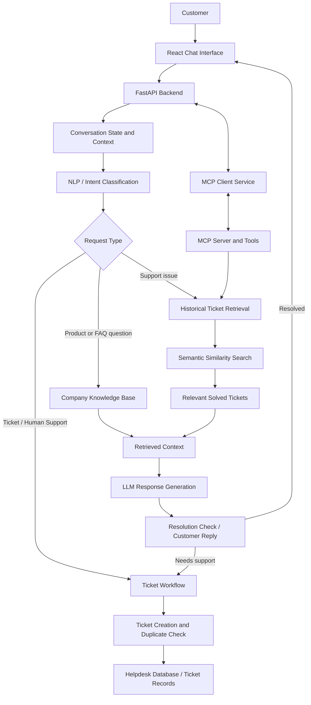

# AI Helpdesk Bot

An AI-powered customer support chatbot designed to answer customer questions, retrieve useful information from a company knowledge base, learn from previously resolved support tickets, and create support tickets when human assistance is needed.

**Repository:** https://github.com/dharn0907/AI-Helpdesk-Bot

---

## Contents

- [Project Overview](#project-overview)
- [Features](#features)
- [System Architecture](#system-architecture)
- [How the Conversation Works](#how-the-conversation-works)
- [MCP Integration](#mcp-integration)
- [Technology Stack](#technology-stack)
- [Repository Structure](#repository-structure)
- [Requirements](#requirements)
- [Setup](#setup)
- [Run the Application](#run-the-application)
- [Testing MCP](#testing-mcp)
- [Configuration and Secrets](#configuration-and-secrets)
- [Troubleshooting](#troubleshooting)
- [Limitations](#limitations)
- [Future Improvements](#future-improvements)

---

## Project Overview

Traditional support systems often require customers to search FAQs, repeat their problems, or contact support through separate channels. This project combines a conversational AI interface with helpdesk ticket workflows to make customer support easier.

The chatbot first tries to resolve the customer's question using the company's configured knowledge and relevant historical tickets. If the problem cannot be resolved through the available information, the system can collect details and create a ticket for human support.

The system is designed as a chatbot and support-assistance system—not as an autonomous human support agent.

### Goals

1. Understand the customer's message and intent.
2. Answer product or service questions using the configured company knowledge.
3. Retrieve relevant previously resolved tickets to reuse their solutions when appropriate.
4. Avoid unnecessary duplicate tickets.
5. Collect the required information and create a support ticket when escalation is needed.
6. Keep each company's knowledge and support data separated.

---

## Features

### Conversational support

- Chat-based customer interaction.
- Conversation history and context handling.
- Intent recognition and routing for different types of customer requests.
- LLM-assisted response generation.
- Responses grounded in available company information and retrieved context.

### Company knowledge base

- Company-specific knowledge is used to ground responses.
- The shared language model is used for understanding and response generation; company-specific knowledge is supplied as context rather than requiring a separate LLM to be trained for each company.
- Company data should remain isolated from other companies' data.

### Historical ticket retrieval

- Searches previously handled support tickets for relevant problems.
- Uses semantic similarity to retrieve tickets that may describe the same or a related issue, even when the wording differs.
- Can use solutions from closed/resolved tickets to help answer a new customer.
- Retrieval results are used as context; a similar ticket is not automatically assumed to be a correct solution for every customer.

### Ticket management

- Collects issue details and customer information needed for ticket creation.
- Creates support tickets through the backend ticket workflow.
- Includes duplicate-ticket checks to help prevent repeated submissions.
- Supports escalation when a customer requests human support.
- Tracks ticket/conversation information through backend services.

### MCP (Model Context Protocol)

- Includes an MCP server in `backend/mcp_server/server.py`.
- Exposes backend retrieval capabilities as MCP tools.
- MCP tools provide a standardized interface for AI/application components to access supported backend functions.
- An MCP client service is included in `backend/services/mcp_client_service.py`.

### Additional processing

The backend also contains image/OCR-related routes and services. Availability and exact behavior depend on the current configuration and installed dependencies.

---

## System Architecture



### Architecture components

| Component | Responsibility |
|---|---|
| React frontend | Customer-facing chat UI and interaction |
| FastAPI backend | API layer and coordination of chatbot workflows |
| Conversation management | Maintains session/context and conversation state |
| Intent classification / NLP | Identifies what the customer is asking for and supports routing |
| Knowledge retrieval | Finds relevant company-specific information |
| Historical ticket retrieval | Finds semantically related prior support cases |
| LLM service | Generates natural-language replies using relevant context |
| Ticket services | Collects ticket details, checks duplicates, and creates tickets |
| MCP server | Exposes supported backend capabilities through MCP tools |
| Database | Stores application, conversation, and ticket data as configured |

---

## How the Conversation Works

A typical customer interaction follows this sequence:

1. The customer sends a message in the web chat.
2. The frontend sends it to the backend API.
3. The backend uses conversation context and NLP/intent classification to understand the request.
4. The system searches the appropriate company knowledge or historical support information when needed.
5. Retrieved information is passed to the response-generation component as context.
6. The chatbot returns an answer or asks a clarifying question.
7. If the customer still needs support or explicitly requests human support, the ticket workflow collects the required information.
8. The system checks for possible duplicate tickets and creates a ticket through the backend workflow.
9. The chatbot confirms the ticket details to the customer.

### Historical-ticket reuse

When a customer describes a problem, the retrieval service can search previously resolved tickets for similar cases. If a relevant resolution is found, the chatbot can present the solution and ask whether it helped.

This is retrieval-based improvement: useful prior resolutions can be reused through retrieval without retraining the entire language model on every ticket.

---

## MCP Integration

**Model Context Protocol (MCP)** is a standardized protocol for connecting AI applications to tools and external capabilities.

In this project, MCP is used to expose selected backend capabilities—particularly support-ticket retrieval—as tools that an MCP-compatible client can discover and invoke.

### MCP files

```text
backend/
├── mcp_server/
│   └── server.py
└── services/
    └── mcp_client_service.py
```

- `mcp_server/server.py` — defines and runs the MCP server and its exposed tools.
- `mcp_client_service.py` — client-side integration used by the backend to communicate with MCP functionality.

### Start the MCP server

Open a separate PowerShell terminal:

```powershell
cd D:\bot\AI-Helpdesk-Bot\backend
.\venv\Scripts\python.exe -m mcp_server.server
```

Keep this terminal running if your current application setup requires the MCP server as a separate process.

### Inspect MCP tools with MCP Inspector

If Node.js/npm are installed, launch the Inspector:

```powershell
npx @modelcontextprotocol/inspector
```

Follow the local URL printed in the terminal.

For a local **STDIO** connection, configure:

- **Command:** `D:\bot\AI-Helpdesk-Bot\backend\venv\Scripts\python.exe`
- **Arguments:** `-m mcp_server.server`
- **Working directory:** `D:\bot\AI-Helpdesk-Bot\backend`

Connect to the server and use the Inspector's tools view to see the tools actually exposed by the current server implementation, inspect their input schemas, and test calls.

> MCP is a backend integration. The customer-facing chat interface does not need to display MCP itself.

---

## Technology Stack

| Area | Technology |
|---|---|
| Frontend | React, Vite, JavaScript |
| Backend/API | Python, FastAPI |
| API server | Uvicorn |
| AI response generation | Gemini integration (configured in backend) |
| NLP / ML | Python ML ecosystem; model/service implementations are in `backend/ai_models` and `backend/services` |
| Semantic retrieval | Sentence Transformers / embeddings-based similarity (used by retrieval components) |
| MCP | Model Context Protocol Python SDK / FastMCP |
| Data layer | Database and ORM models in `backend/database` |
| OCR/image processing | Backend image/OCR services (optional/configuration-dependent) |

---

## Repository Structure

```text
AI-Helpdesk-Bot/
├── backend/
│   ├── main.py
│   ├── ai_models/
│   ├── database/
│   │   └── models.py
│   ├── mcp_server/
│   │   └── server.py
│   ├── routes/
│   │   └── ticket_routes.py
│   ├── services/
│   │   ├── mcp_client_service.py
│   │   ├── conversation_logging_service.py
│   │   ├── duplicate_ticket_service.py
│   │   ├── similar_ticket_service.py
│   │   └── ticket_retrieval_service.py
│   ├── tests/
│   ├── venv/                 # Local virtual environment (not committed)
│   └── ...
├── frontend/
│   ├── src/
│   │   └── App.jsx
│   ├── package.json
│   └── ...
├── agent-frontend/            # If present in this checkout
├── .gitignore
└── README.md
```

The repository may contain additional modules and data folders; the structure above highlights the main application components.

---

## Requirements

- Windows 10/11 (commands below are written for PowerShell)
- Python 3.11 recommended for the current development environment
- Node.js and npm
- Git
- API credentials for the external LLM provider used by your backend, if required
- Database configuration required by the current project setup

---

## Setup

### 1. Clone the repository

```powershell
git clone https://github.com/dharn0907/AI-Helpdesk-Bot.git
cd AI-Helpdesk-Bot
```

### 2. Set up the Python backend

```powershell
cd backend
py -3.11 -m venv venv
.\venv\Scripts\Activate.ps1
python -m pip install --upgrade pip
```

Install the backend dependencies using the repository's dependency file, if present:

```powershell
pip install -r requirements.txt
```

If the project dependency file has a different name or is maintained in another directory, use the dependency file committed with the repository.

### 3. Configure environment variables

Create a local `.env` file in the location expected by the backend configuration. Use the project's `.env.example` as a template if one is present.

Add the required API credentials and database configuration for your local setup. Do not commit the real `.env` file.

### 4. Set up the frontend

Open another PowerShell terminal:

```powershell
cd D:\bot\AI-Helpdesk-Bot\frontend
npm install
```

---

## Run the Application

### Backend

From the backend directory, with the virtual environment installed:

```powershell
cd D:\bot\AI-Helpdesk-Bot\backend
.\venv\Scripts\python.exe -m uvicorn main:app --host 127.0.0.1 --port 8000 --reload
```

Backend base URL:

```text
http://127.0.0.1:8000
```

If the API defines OpenAPI documentation, check:

```text
http://127.0.0.1:8000/docs
```

### Frontend

In another terminal:

```powershell
cd D:\bot\AI-Helpdesk-Bot\frontend
npm run dev
```

Open the Vite URL printed in the terminal (commonly `http://localhost:5173`).

> If your frontend or backend uses a different port, follow the URL printed by the development server and the API configuration in the code.

### MCP server (separate terminal, if required)

```powershell
cd D:\bot\AI-Helpdesk-Bot\backend
.\venv\Scripts\python.exe -m mcp_server.server
```

---

## Testing MCP

1. Start the MCP server in its terminal.
2. Launch MCP Inspector with `npx @modelcontextprotocol/inspector`.
3. Connect using the local STDIO configuration listed in [MCP Integration](#mcp-integration).
4. Inspect the available tools.
5. Select a tool, enter its required input, and execute it.
6. Review the tool output to confirm what data the server returns.

For retrieval tools, use test data that is safe to share and avoid exposing private customer records during a demonstration.

---

## Configuration and Secrets

- Keep API keys and credentials in local environment variables or `.env` files.
- Do not commit API keys, access tokens, passwords, private customer data, database files, or local model artifacts.
- Keep `.env`, virtual environments, caches, generated files, and private datasets excluded in `.gitignore`.
- Use `.env.example` with placeholder values to document required configuration without exposing secrets.
- Apply company/customer data isolation to retrieval and ticket queries.

---

## Troubleshooting

### Backend does not start

- Confirm Python 3.11 is installed.
- Activate the correct backend virtual environment.
- Install dependencies from the backend dependency file.
- Check the terminal traceback and required environment variables.
- Ensure the configured port is not already in use.

### Frontend cannot connect to the backend

- Confirm the backend is running.
- Check the frontend API base URL.
- Check backend CORS configuration for the frontend's local URL/port.
- Check browser developer tools for the request error.

### MCP server fails to launch

- Run the command from the backend directory.
- Confirm the virtual environment contains the MCP package.
- Verify the module path `mcp_server.server`.
- Review the MCP server terminal for startup errors.

### MCP Inspector cannot connect

- Confirm the command points to the project's virtual-environment Python executable.
- Confirm the arguments are `-m mcp_server.server`.
- Set the working directory to the backend directory.
- Ensure the server process can start independently.

### AI response or retrieval errors

- Check required API credentials.
- Check network connectivity to the configured model provider.
- Confirm the retrieval model and its dependencies are installed.
- Review the backend logs for retrieval, model-loading, or database errors.

---

## Limitations

- AI-generated answers may be incomplete or incorrect; retrieved context does not guarantee correctness.
- A semantically similar ticket may not have the same root cause as the current customer's problem.
- Retrieval quality depends on the quality, availability, and relevance of historical ticket data.
- Human support tickets may still be necessary for unresolved, sensitive, or complex issues.
- External AI services may require valid credentials, internet access, and may have usage limits.
- The exact supported integrations and tools depend on the configuration and code deployed.

---

## Future Improvements

Potential improvements include:

- Stronger retrieval evaluation and relevance thresholds.
- Customer feedback tracking to identify whether retrieved solutions resolve issues.
- More robust ticket categorization and assignment.
- Improved analytics for ticket trends, repeated issues, and resolution rates.
- Expanded MCP tools and clearer tool-level permissions.
- Automated testing for chat flows, ticket creation, duplicate detection, and retrieval.
- Deployment configuration, monitoring, and logging.
- Improved accessibility and multilingual customer experience.

---

## Contributing / Development

For local development:

1. Create a branch for your change.
2. Make the changes and run the relevant checks.
3. Review the diff for secrets, generated files, and unrelated changes.
4. Commit with a descriptive message.
5. Push the branch and open a pull request (or merge according to your team's workflow).

---

## Author / Project

**AI Helpdesk Bot**  
Repository: [dharn0907/AI-Helpdesk-Bot](https://github.com/dharn0907/AI-Helpdesk-Bot)

